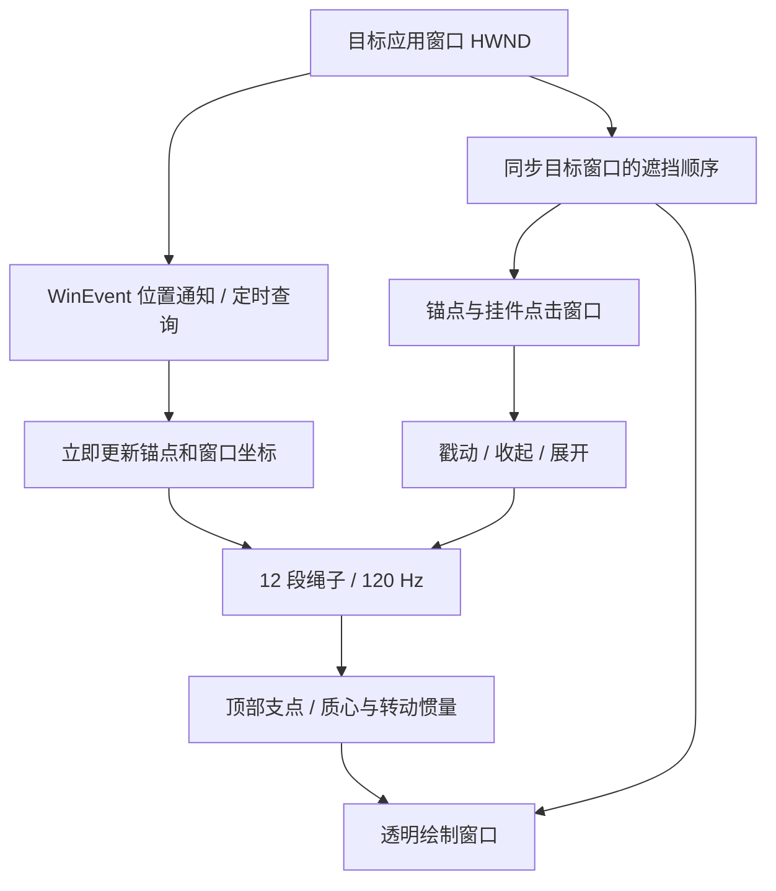

# Window Pet 0.0.1-pre：核心与架构

研究日期：2026-10-06。基线是用户确认通过的 `9fdfb1b` 物理效果。本次发布准备保留所有物理参数；增加图片内嵌、版本信息、许可证展示、发布构建和采样脚本。

## 当前核心

程序是 C# / .NET Framework + WinForms + Win32 / GDI+。没有浏览器、Electron、Unity、JavaScript 运行时，也没有注入目标应用。目标窗口只需提供一个可观察的顶层 HWND。

| 部分 | 实现 | 职责与可移植程度 |
| --- | --- | --- |
| 设置界面 | `SettingsForm`，`WindowPet.cs` | 窗口、挂件、四角、四档长度；Windows 专用 |
| 窗口控制与调度 | `PetForm` + `Win` | HWND 枚举、坐标、事件、遮挡顺序、收起状态和定时器；Windows 专用，尚未从 PetForm 完全拆开 |
| 绳子数学核 | `VerletRopeSolver.cs` | 双精度 Verlet 积分、相邻距离约束；只依赖 System，最容易复用 |
| 挂绳适配 | `RopePhysics.cs` | 12 段/13 点、120 Hz 固定步长、固定根节点、端点重力、窗口运动输入；数学可移植，PointF 要替换为自有向量类型 |
| 挂件旋转 | `PetBodyPhysics.cs` | 以顶部挂点为支点，重力和支点加速度产生转矩；数学可移植，图片 alpha 扫描需平台适配 |
| 显示 | `LayeredSurface.cs` + `DrawScene` | GDI+ 抗锯齿路径、预乘 alpha、UpdateLayeredWindow；Windows 专用 |
| 点击 | 两个 `HitForm` | 只在锚点和挂件的椭圆区域接收点击；大绘制窗整体穿透 |
| 内置资源 | `PetAssets.cs` | 从 EXE 资源流加载图片和声明；不解压到磁盘 |

这是一条主要由 UI 线程执行的循环。一个挂件有一个绘制 HWND 和两个输入 HWND；设置窗另有一个 HWND。位置事件即时跟随；运动时定时器约 16 ms，静止/收起约 66 ms。静止时跳过物理积分，未变化时跳过重绘；收起后不模拟绳子。

窗口不设置 TopMost。程序按目标窗口附近的 Z 顺序插入三层窗口，其他应用正常遮挡挂件。位置事件使用进程外 WinEventHook；[微软文档](https://learn.microsoft.com/en-us/windows/win32/api/winuser/nf-winuser-setwineventhook)说明这种通知不把回调 DLL 映射到目标进程，并在注册线程送达。目标应用的 32/64 位与挂件进程不必相同。

## 物理模型的准确含义

- 绳子中间点的重力为零；末端有重力，中间点仍有用于约束求解的惯性自由度。它是经过调试的离散视觉模拟。
- 12 段距离约束保持长度，允许松绳弯曲；相对窗口平移的阻尼处理慢速拖动，速度限制处理突发移动。
- 图片 alpha 作为均匀材质的质量分布估计，顶部中心作为挂点。高质量缩放后的实际栅格质心约 `(-0.475, 85.418) px`，支点转动惯量/质量约 `9527.96 px²`。32 位栅格化存在很小数值差异。
- 挂件角运动使用绳尾的加速度；旋转反作用没有反馈给绳子。当前并非完整双向刚体求解器。
- 上游 JS 与 C# 的基础积分/约束逻辑已用 450 个参考位置验证，最大误差约 `9.66e-13`。原始 JS 只用于开发测试。

## 为什么占用低

常驻数据很小：13 个节点和固定数组；约 1.01 MiB 的 `600×440×4` 复用绘制 DIB；约 0.36 MiB 的 `320×296×4` 挂件栅格。图片解码和质心扫描只在挂载时发生。求解器每步不新建节点数组，原生 DC/DIB 和图片在关闭挂件时释放。

整个进程仍要加载 CLR、WinForms、GDI+ 和系统 DLL；其共享页面也计入总工作集。资源小不等于所有内存指标只有 14 MB。长期观察方法见 [兼容性与占用](COMPATIBILITY.md)。

## 后续拆分方向

先保留当前已通过的效果，再把以下边界从 PetForm 提取出来：

1. `WindowTracker`：输出目标边界、可见/最小化状态和运动事件。
2. `OverlayHost`：绘制面、输入区域、窗口顺序、显示器坐标转换。
3. `PendantSimulation`：只接收物理坐标和 dt，输出节点与角度。
4. `AssetCatalog`：资源 ID、图像、挂点、质量分布元数据。

平台接口输出统一的屏幕坐标；所有物理参数以逻辑单位定义，再由平台层转换成像素。跨显示器变化需要重建显示面并重置运动历史，避免 DPI 变化成为一次假冲量。本文是边界设计，当前没有为跨平台重写物理核。
